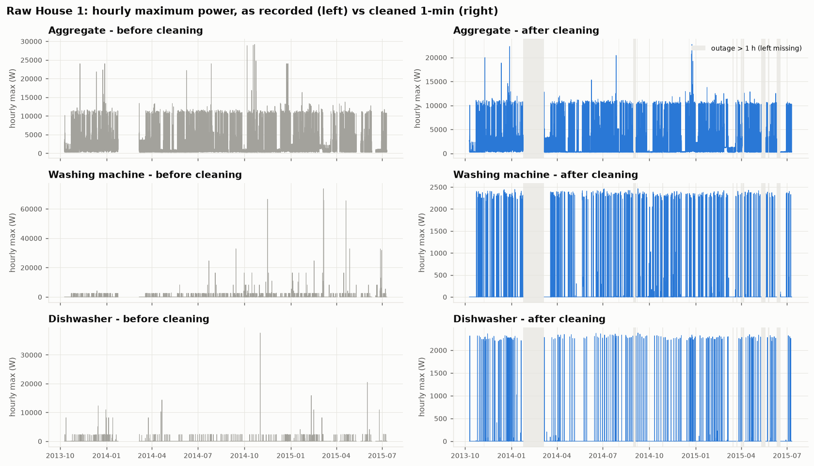
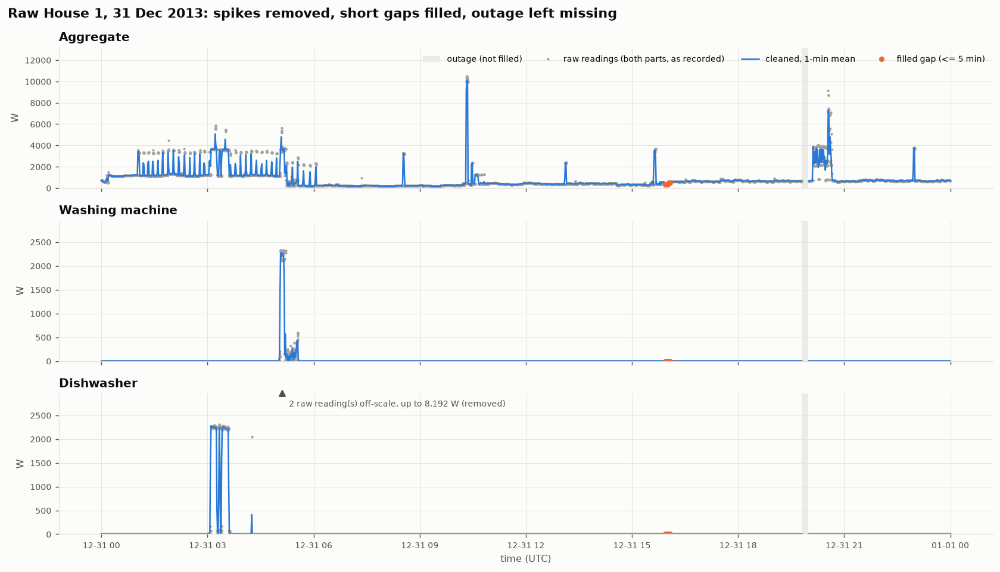
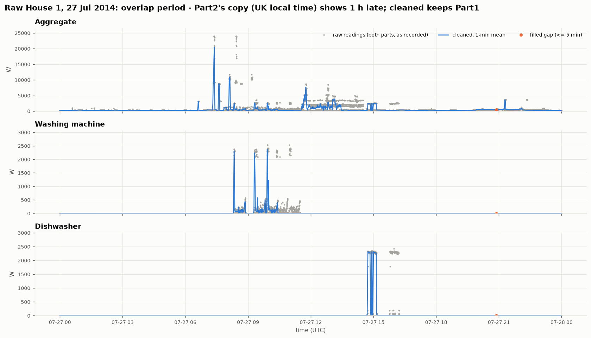

# DATA.md — coverage, quality findings and cleaning decisions

All numbers below are produced by the code and saved under [`results/`](results/); re-running
`python -m src.section1_raw` and `python -m src.prepare_clean` regenerates them.

---

## 1. The dataset

**REFIT Electrical Load Measurements** (University of Strathclyde), CC BY 4.0.
Murray, D., Stankovic, L. & Stankovic, V. (2017). *An electrical load measurements dataset of
United Kingdom households from a two-year longitudinal study.* Scientific Data 4, 160122.
[doi:10.1038/sdata.2016.122](https://doi.org/10.1038/sdata.2016.122)

| Item | Value |
|---|---|
| Households | 20 homes near Loughborough, UK, numbered 1–21 (no House 14) |
| Channels per home | 1 whole-home current clamp (`Aggregate`) + 9 plug-level appliance monitors (`Appliance1`–`Appliance9`) |
| Quantity, unit | Active power, **watts (W)** |
| Nominal sampling | 8 s (measured median interval: 7 s) |
| Period | Sep 2013 – Jul 2015 (varies by home) |
| Versions | **RAW** (two parts per home) and **CLEAN** (one file per home, post-processed by the authors) |

**Files used**

| Section | Files | Period |
|---|---|---|
| 1 — raw cleaning | `RAW_House1_Part1.csv`, `RAW_House1_Part2.csv` | 2013-10-09 → 2015-07-10 (UTC) |
| 2–3 — EDA and model | `CLEAN_House{N}.csv` for N = 1, 2, 5, 6, 7, 8, 9, 10, 15, 16, 17, 18, 19, 20 | full span of each file; see [`results/clean_screening.csv`](results/clean_screening.csv) |

**Documented limitations** (readme and Murray et al., 2017)
- **Solar PV distorts the aggregate of Houses 3, 11 and 21** ("re-wiring was not possible"); solar
  shows up as extra consumption. Houses 1, 6 and 7 also have PV but were rewired to remove it.
- Appliance monitors (IAMs) report **asynchronously**; a reading can be up to ~7 s old, and IAMs
  can lead the aggregate. Irrelevant at 1-minute resolution.
- The clamp does **not measure voltage**, so watts are approximate.
- Householders sometimes **moved or swapped** monitored appliances (e.g. House 13's washing machine
  changed on 25 Mar 2015).
- Sometimes the sum of IAMs exceeds the aggregate; CLEAN marks those rows `Issues = 1`.
- In RAW, `NaN` means "no new reading" (unchanged load or no response). RAW Part1 wrote **0** for
  an unavailable sensor; Part2 wrote **NaN**.
- In CLEAN, gaps < 2 min were forward-filled and **longer gaps were filled with zeros**, so a zero
  in CLEAN can mean "missing", not "off".
- 20 owner-occupied homes in one English town: not a representative sample, even of the UK.

---

## 2. Raw House 1: inspection findings

From [`results/s1_inspection.csv`](results/s1_inspection.csv), measured **before** any cleaning.

| Check | Part1 | Part2 | What it means |
|---|---|---|---|
| Rows | 4,377,877 | 4,140,886 | |
| Span (as recorded) | 2013-10-09 → 2014-10-01 | 2014-06-27 → 2015-07-10 | **~3 months recorded in both parts** |
| Timestamp parsing | 0 unparseable | 0 unparseable | `Time` is exactly `Unix` printed as text (0 rows differ by > 1 s) |
| Ordering | **1 backwards step** | 0 | 27 Oct 2013 01:59:59 → 01:00:01: the clocks going back |
| Exact duplicate rows | 884,307 | 393 | the same reading written repeatedly |
| Duplicate timestamps | 1,004,404 | 14,755 | |
| …with differing values | 120,097 | 14,362 | Part2: mostly rows carrying *different sensors* (NaN elsewhere); only 155 truly conflict |
| Median / p99 interval | 7 s / 16 s | 7 s / 9 s | irregular: Part1 ~15 s for long stretches |
| Gaps > 5 min / > 1 h | 380 / 14 | 72 / 19 | outages |
| Missing values (NaN) | 0 % everywhere | Aggregate 4.6 %, IAMs 5.6–12.3 %, heater 46 % | Part1 wrote 0 instead of NaN |
| Negative values | 0 | 0 | |
| Aggregate > 23 kW | 26 | 51 | above the physical limit (max 29,159 W) |
| Appliance > 4 kW | 3,038 | 911 | max values 32,767 / 65,535 / 98,301 W: **sensor error codes**, not power |

### Two findings the checklist doesn't name, but which mattered most

**(a) The two parts use different clocks.** RAW `Unix` in Part1 is **UK wall-clock time** (BST in
summer), not UTC: the October clock change appears as a backwards step, and the March clock-change
hour has no rows at all. Part2 switches to **UTC from October 2014**. Evidence: month by month, the
RAW aggregate correlates ≥ 0.999 with the official (UTC) data *only* under the right clock
assumption ([`results/s1_clock_check.csv`](results/s1_clock_check.csv)):

| Part | Months | Matches official data as |
|---|---|---|
| Part1 | Oct 2013, Mar–Sep 2014 (BST) | UK local time |
| Part2 | Jun–Sep 2014 (BST) | UK local time |
| Part2 | Oct 2014, Mar–Jul 2015 (BST) | **UTC** |
| both | Nov–Feb | either (GMT = UTC) |

**(b) The overlap is not two identical copies.** For 27 Jun – 1 Oct 2014 both parts hold data, but
they disagree minute by minute (correlation 0.79). The official CLEAN file was clearly built from
**Part1** there ([`results/s1_overlap_check.csv`](results/s1_overlap_check.csv)):

| Overlap, 121k minutes | MAE vs official | Correlation | Minutes within 1 W |
|---|---|---|---|
| Aggregate — Part1 | **3.3 W** | **0.999** | 90.7 % |
| Aggregate — Part2 | 57.6 W | 0.794 | 44.5 % |
| Washing machine — Part1 | **0.2 W** | **0.999** | 99.0 % |
| Washing machine — Part2 | 4.0 W | 0.805 | 97.7 % |

My first rule preferred Part2 (it has NaN instead of ambiguous zeros, and samples more evenly).
This comparison reversed that choice.

---

## 3. Cleaning pipeline (`src/section1_raw.py`)

From [`results/s1_cleaning_log.csv`](results/s1_cleaning_log.csv):

| # | Step | Rows after | Rule and reason |
|---|---|---|---|
| 0 | Load | 8,518,763 | both parts, as recorded |
| 1 | **Timestamps → UTC** | 8,517,564 | Part1 converted from UK local time. The repeated hour on 27 Oct 2013 cannot be split reliably into BST and GMT, so its **1,199 readings are dropped** (one hour). Part2 kept data is already UTC. |
| 2 | **Resolve overlap** | 7,572,614 | **Keep Part1 until it ends, then Part2**; 944,950 Part2 rows dropped. Reason: §2(b). |
| 3 | Sort | 7,572,614 | stable sort on the UTC timestamp |
| 4 | **Impossible values → NaN** | 7,572,614 | aggregate > **23,000 W** (100 A main fuse × 230 V) or < 0; appliance > **4,000 W** (the official REFIT spike threshold) or < 0. 70 aggregate and 3,895 appliance readings. Marked **missing, not zero**: the official pipeline uses zero, which would be read as "off". |
| 5a | **Drop exact duplicates** | 6,688,420 | 884,194 identical rows |
| 5b | **One row per timestamp** | 6,556,603 | where a timestamp still has several rows, **keep the last non-missing reading per channel** (131,817 rows merged). "Last" = most recently written, and taking it per channel keeps every sensor's latest value in Part2's sparse rows. |
| 6 | **Resample to 1 min** | 920,091 minutes | mean of the readings in each minute, labelled by the minute's start. Minutes with no reading stay NaN. |
| 7 | **Short gaps vs outages** | 920,091 | per channel, **forward-fill gaps ≤ 5 min**; longer gaps stay NaN and are flagged `outage`. |

**Why forward fill, and why 5 minutes.** REFIT writes a reading only when the load changes, so
"carry the last value" is how the data was generated; interpolation would invent ramps. Most
gaps are short but hold little time: **802 aggregate minutes were filled (0.09 %)**, while gaps over
a day hold 92 % of missing time. Five minutes is also shorter than any wash-cycle phase, so filling
cannot create or delete a cycle. (The official pipeline fills < 2 min at the 8-s level; at 1-minute
resolution the difference is negligible.)

**Outages flagged, not filled** ([`results/s1_outages.csv`](results/s1_outages.csv)): 409 gaps
longer than 5 min, 84.4 days in total (**13.2 % of minutes** have no aggregate):

| Outage length | Count | Days lost |
|---|---|---|
| 6–15 min | 342 | 2.7 |
| 16–60 min | 42 | 0.8 |
| 1–6 h | 10 | 0.9 |
| 6–24 h | 3 | 2.0 |
| > 1 day | 12 | **77.9** |

The longest runs from 24 Jan to 6 Mar 2014 (41.6 days), matching the readme's "missing data
(notably February 2014)".

---

## 4. Validation: does the simple pipeline reproduce the official CLEAN data?

Our cleaned RAW House 1 compared with the authors' `CLEAN_House1.csv` over 797k shared minutes
([`results/s1_agreement_with_official.csv`](results/s1_agreement_with_official.csv)):

| Channel | MAE | Correlation | Minutes within 1 W |
|---|---|---|---|
| Aggregate | 4.2 W | 0.9991 | 89.2 % |
| Fridge | 0.07 W | 0.9975 | 99.2 % |
| Washing machine | 0.22 W | 0.9985 | 99.1 % |
| Dishwasher | 0.08 W | 0.9997 | 99.7 % |

Before the clock correction, aggregate correlation was only 0.87. So the timestamp step mattered
more than any other, and with it the simple pipeline closely reproduces the official result.

---

## 5. Before / after plots

**Whole period, hourly maximum** — [`figures/s1_overview_before_after.png`](figures/s1_overview_before_after.png)

Left (as recorded): appliance channels reach 30–75 kW, which is impossible for a washing machine or
dishwasher (~2.4 kW heater). Right (cleaned): both appliances sit at their real ~2.3 kW heating
level; grey bands are outages longer than 1 hour, left empty rather than invented. The aggregate's
recurring ~10–11 kW hourly peaks survive cleaning: they are consistent, short and below the supply
limit, plausibly an un-metered electric shower (common in UK homes), so they are kept.

**One day with spikes, short gaps and an outage** — [`figures/s1_zoom_gaps_spikes.png`](figures/s1_zoom_gaps_spikes.png)

Grey dots are every raw reading; the blue line is the cleaned 1-minute series. Two dishwasher
readings of up to 8,192 W (off-scale triangle) are removed. Orange points are the only forward-filled
minutes (a gap ≤ 5 min around 15:50). The grey band near 20:00 is a longer gap, left missing.

**A day in the Part1/Part2 overlap** — [`figures/s1_zoom_overlap.png`](figures/s1_zoom_overlap.png)

Every activity appears **twice** in the raw readings: once at the right time (Part1) and once
**one hour later** (Part2's copy, still on UK local time). For example, the dishwasher runs at 15:00
and its "echo" sits at 16:00. Naively concatenating the parts would double-count every appliance
use in these three months.

---

## 6. Preparing the CLEAN data (Sections 2–3, `src/prepare_clean.py`)

Each house's CLEAN file goes through the **same** resampling and ≤ 5-minute gap rule. The CLEAN
files are already sorted with no duplicate timestamps (checked for all 18 homes with a
washing-machine channel).

- **Timestamps are UTC.** Shown directly in §2(a): the official data matches RAW only when RAW's
  UK local time is converted to UTC. Hour-of-day and day-of-week analysis in Section 2 therefore
  converts to `Europe/London`. Without that, every summer pattern would be off by an hour.
- **Coverage.** Outages per house range from 5.8 % (House 18) to 24.6 % (House 2). This agrees
  with the paper's uptime figures (House 2 lowest at 76 %, House 18 highest at 94 %; ours 75.4 % and
  94.2 % observed).
- **Zeros that mean "missing".** A run where all nine IAMs read exactly 0 for over an hour is
  almost certainly zero-filled (a fridge never stays off that long). This occurs in House 3
  (14.6 % of minutes, excluded anyway) and House 15 (0.56 %, 8 runs ≥ 1 h); elsewhere it is ≤ 0.2 %.
  For a single channel, a zero-filled gap cannot be told apart from "off"; this is a remaining concern.
- **Spikes.** Aggregate maxima reach 46.5 kW (House 16) and 34 kW (House 3), above the 23 kW
  limit; CLEAN only removed spikes on the appliance channels.

**Houses used: 1, 2, 5, 6, 7, 8, 9, 10, 15, 16, 17, 18, 19, 20 (14 homes).** Excluded:

| House | Reason |
|---|---|
| 3, 11, 21 | Solar PV distorts the aggregate (Murray et al., 2017) |
| 4 | Two washing machines on separate channels |
| 13 | Washing machine replaced mid-study (25 Mar 2015) |
| 12, 14 | No washing-machine channel / no such house |

The solar exclusion strictly matters only where the aggregate is used. I keep one set of houses for
both Sections 2 and 3 so that results are comparable.

---

## 7. Remaining concerns

1. **Part1 zeros.** Part1 wrote 0 for an unavailable sensor, so some "off" minutes in Oct 2013 –
   Sep 2014 are really missing. They cannot be separated from true zeros without extra information.
2. **Residual aggregate peaks.** 8 cleaned minutes exceed 20 kW. They pass the 23 kW physical limit
   but are probably glitches. A rolling-median spike filter would catch them; not done, to keep the
   rules simple and auditable.
3. **One limit for all appliances.** The 4 kW cap catches error codes but not a 3 kW "fridge" reading.
   Per-appliance limits (fridge ≈ 300 W) would be better but need appliance-specific knowledge.
4. **The dropped clock-change hour** (27 Oct 2013) and a possible ±1 h seam where Part2 takes over
   (1 Oct 2014) affect about 2 hours of 639 days.
5. **Electric heater channel** (Appliance9) is 23 % missing, mostly Part2's sparse reporting; not
   used downstream.
6. **CLEAN zero-filling** (§6) means zero/off time for the washing machine is an upper bound.
