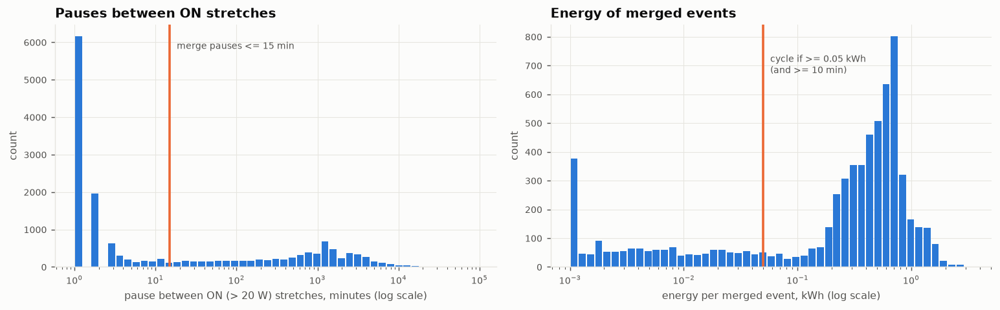
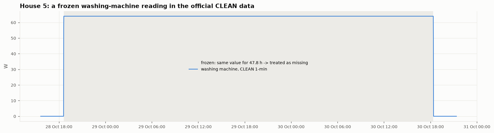
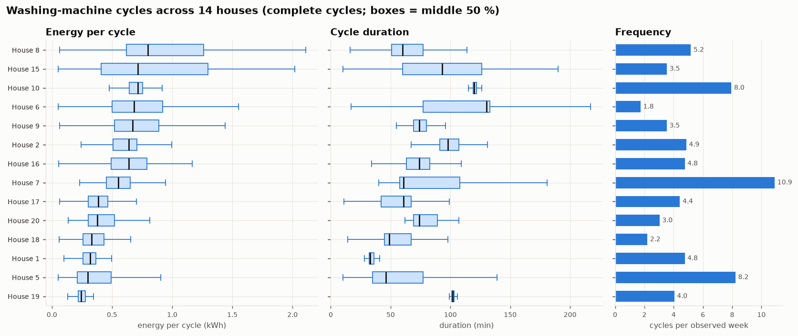
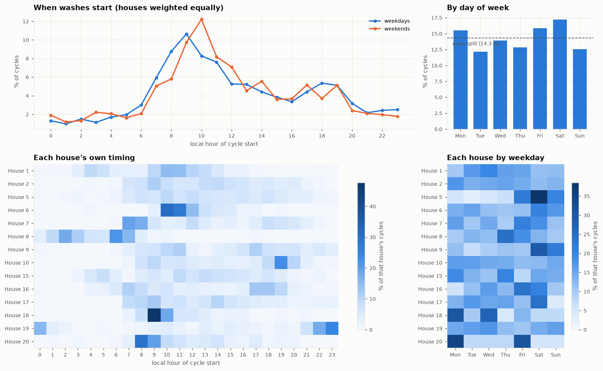
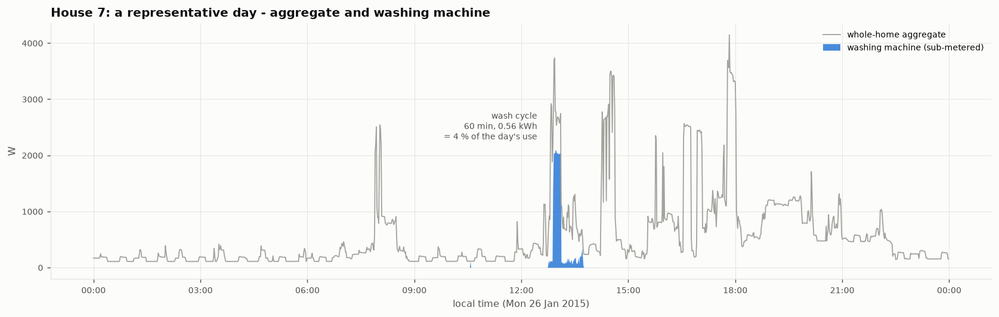
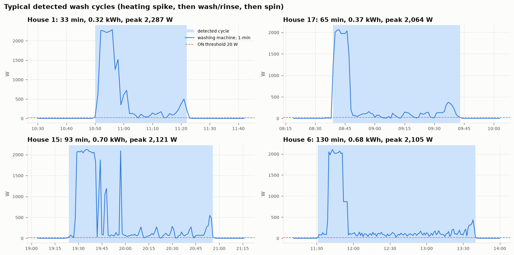

# RESULTS.md — washing-machine EDA and disaggregation model

Figures are in [`figures/`](figures/) and tables in [`results/`](results/); everything is regenerated by
the scripts listed in the README. All times in this file are **UK local time** (Europe/London); the
CLEAN timestamps are UTC (DATA.md §6), so they are converted before any hour-of-day analysis.

---

## Section 2 — Washing-machine use in the official CLEAN data

**Homes and periods.** 14 homes: 1, 2, 5, 6, 7, 8, 9, 10, 15, 16, 17, 18, 19, 20, at 1-minute
resolution, each over its full CLEAN record (earliest Sep 2013, latest Jul 2015). Together that is
**6,801 observed house-days**. See DATA.md §6 for why homes 3, 4, 11, 13 and 21 are excluded.

### 2.1 Rule for an active wash cycle

In plain language: **the machine is running when it draws more than 20 W. Pauses of up to 15
minutes still belong to the same wash. A wash must last at least 10 minutes and use at least
0.05 kWh.**

| Element | Value | Why |
|---|---|---|
| ON threshold | **> 20 W** | Standby is < 10 W in every house (House 5 idles at 1–5 W for 41 % of the time); 20 W is also the washing-machine threshold used by Kelly & Knottenbelt (2015) |
| Merge pauses | **≤ 15 min** | A wash stops drawing power while filling, soaking and draining. Pauses between ON stretches are mostly 1–5 min (inside a wash) or > 4 h (between washes); 15 min sits in the sparse middle |
| Minimum size | **≥ 10 min and ≥ 0.05 kWh** | Event energy is bimodal: blips (display, door lock) < 0.02 kWh vs washes at 0.2–1 kWh. 1,682 blips rejected |
| Missing data | outages and **frozen readings** are missing, never "off" | a cycle touching missing data is counted but flagged *truncated* (234 of 4,951) and excluded from duration/energy comparisons |

*Left:* the pause distribution has a large mass at 1–3 min and a broad hump at hours to days, with
no clean valley in between. The 15-minute merge is therefore a judgement call, so we test it below.
*Right:* blips and real washes form two clearly separate groups; the 0.05 kWh line sits in the gap.

**Sensitivity** ([`results/s2_rule_sensitivity.csv`](results/s2_rule_sensitivity.csv)): total cycles
under other settings.

| merge gap \ min energy | 0.02 kWh | **0.05 kWh** | 0.10 kWh |
|---|---|---|---|
| 5 min | 5,404 | 5,181 | 5,024 |
| 10 min | 5,234 | 5,049 | 4,916 |
| **15 min** | 5,114 | **4,951** | 4,830 |
| 30 min | 4,863 | 4,730 | 4,624 |
| 60 min | 4,620 | 4,497 | 4,398 |

Changing the merge gap from 10 to 30 minutes moves the count by under ±5 %, so the conclusions
below do not hinge on the exact values.

**A data-quality problem found by the rule: frozen readings.** In the CLEAN data, a monitor that
stopped reporting can show its last value repeated for hours, because the official pipeline
forward-fills. A real machine's power changes every minute, so **an identical reading above 20 W
for 30+ minutes is treated as missing**. This removes 2.4 % of House 5's minutes (124 runs, up to 2 days
long) and ≤ 0.04 % elsewhere. Without it, House 5 showed "washes" lasting 13 hours at a constant
2,129 W.

### 2.2 Availability and data quality

From [`results/s2_availability.csv`](results/s2_availability.csv). "Zero" and "standby" are shares
of *observed* minutes; "outage" is the share of the whole span.

| House | Period | Observed days | Outage % | Outages > 1 day | Zero % | Standby (0–20 W) % | In a cycle % | Cycles (truncated) | Cycles / week |
|---|---|---|---|---|---|---|---|---|---|
| 1 | 2013-10-09 → 2015-07-10 | 559 | 12.5 | 12 | 97.6 | 0.6 | 2.0 | 380 (24) | 4.8 |
| 2 | 2013-09-17 → 2015-05-28 | 466 | 24.6 | 11 | 94.4 | 0.9 | 5.0 | 324 (31) | 4.9 |
| 5 | 2013-09-26 → 2015-07-06 | 574 | 9.2 | 9 | 53.5 | 41.2 | 5.4 | 674 (81) | 8.2 |
| 6 | 2013-11-28 → 2015-06-28 | 491 | 15.0 | 13 | 97.4 | 0.7 | 1.9 | 123 (10) | 1.8 |
| 7 | 2013-11-01 → 2015-07-08 | 537 | 12.5 | 11 | 74.9 | 16.8 | 8.4 | 836 (17) | 10.9 |
| 8 | 2013-11-01 → 2015-05-11 | 499 | 10.2 | 8 | 84.1 | 12.6 | 3.4 | 369 (2) | 5.2 |
| 9 | 2013-12-17 → 2015-07-08 | 481 | 15.3 | 9 | 90.6 | 6.7 | 2.7 | 243 (7) | 3.5 |
| 10 | 2013-11-20 → 2015-06-30 | 523 | 10.9 | 12 | 90.2 | 1.1 | 9.0 | 594 (25) | 8.0 |
| 15 | 2013-12-17 → 2015-07-08 | 491 | 13.5 | 11 | 96.2 | 0.9 | 3.1 | 248 (10) | 3.5 |
| 16 | 2014-01-10 → 2015-07-08 | 450 | 17.2 | 14 | 93.3 | 3.0 | 3.8 | 306 (8) | 4.8 |
| 17 | 2014-03-06 → 2015-06-19 | 441 | 6.1 | 6 | 96.6 | 1.0 | 2.6 | 279 (5) | 4.4 |
| 18 | 2014-03-07 → 2015-05-24 | 417 | 5.8 | 7 | 98.5 | 0.3 | 1.2 | 132 (3) | 2.2 |
| 19 | 2014-03-06 → 2015-06-20 | 441 | 6.3 | 7 | 86.6 | 9.6 | 3.9 | 255 (8) | 4.0 |
| 20 | 2014-03-20 → 2015-06-23 | 433 | 5.9 | 6 | 97.2 | 0.4 | 2.5 | 188 (3) | 3.0 |
| **All** | | **6,801** | | | | | | **4,951 (234)** | |

What this shows:
- **The machine is idle 91–98 % of the time.** That class imbalance shapes the model evaluation in
  Section 3.
- **"Zero" is not the same as "off".** Some machines report an exact 0 when idle, others a 1–20 W
  standby (Houses 5, 7, 8, 19). Separately, CLEAN zero-fills gaps longer than 2 min, so zero time is
  an *upper bound* on true off time (DATA.md §7).
- **Every house has 6–14 outages longer than a day, and the long ones are simultaneous.** All homes
  that were recording went dark together on 24 Jan – 5 Mar 2014 (41 days), 22–24 Mar, 3–6 Apr,
  11–19 May and 11–17 Jun 2015. These are central data-collection failures, not household problems,
  so no home can stand in for another during them.
- Truncated cycles are rare (4.7 %) except in House 5 (12 %, from frozen-sensor gaps) and House 2
  (10 %, worst coverage).

### 2.3 Cycle characteristics across homes

Complete cycles only ([`results/s2_cycle_summary.csv`](results/s2_cycle_summary.csv)). Over all
4,717 complete cycles: median **71 min**, **0.54 kWh**, peak **2.1 kW**.

| House | Cycles | Duration, median (IQR) min | Energy, median (IQR) kWh | Peak, median W | WM share of house electricity |
|---|---|---|---|---|---|
| 1 | 356 | 33 (32–36) | 0.32 (0.26–0.36) | 2,327 | 2.2 % |
| 2 | 293 | 98 (91–107) | 0.64 (0.51–0.71) | 2,092 | 3.9 % |
| 5 | 593 | 46 (35–77) | 0.30 (0.21–0.49) | 2,078 | 3.1 % |
| 6 | 113 | 130 (77–133) | 0.68 (0.50–0.92) | 2,059 | 1.5 % |
| 7 | 819 | 61 (58–108) | 0.55 (0.45–0.65) | 2,083 | 6.7 % |
| 8 | 367 | 60 (51–77) | 0.80 (0.62–1.26) | 2,337 | 4.3 % |
| 9 | 236 | 74 (69–80) | 0.67 (0.52–0.89) | 2,210 | 2.6 % |
| 10 | 569 | 120 (119–122) | 0.72 (0.64–0.76) | 2,056 | 4.3 % |
| 15 | 238 | 93 (60–126) | 0.72 (0.41–1.30) | 2,184 | 6.7 % |
| 16 | 298 | 74 (63–83) | 0.64 (0.49–0.79) | 2,050 | 3.5 % |
| 17 | 274 | 61 (42–67) | 0.39 (0.30–0.46) | 2,046 | 2.6 % |
| 18 | 129 | 49 (45–67) | 0.33 (0.26–0.43) | 2,192 | 1.1 % |
| 19 | 247 | 102 (101–103) | 0.24 (0.22–0.28) | 1,759 | 2.2 % |
| 20 | 185 | 74 (69–89) | 0.38 (0.30–0.52) | 2,273 | 2.1 % |

**(iii) Cross-house comparison** — [`figures/s2_cross_house.png`](figures/s2_cross_house.png)

*Interpretation.* The **peak** is almost the same everywhere (~2.0–2.3 kW): it is the water heater,
so peak power identifies the appliance but says little about the household. **Energy per cycle varies
about 3×** between homes (0.24 kWh in House 19 to 0.80 kWh in House 8), mostly because of **wash
temperature**: how long the heater runs, not how long the drum turns. House 19's 100-minute cycles
use only 0.24 kWh (its peak is the lowest, 1.76 kW), consistent with cool washes. **Duration is a
household habit**: Houses 1, 10 and 19 run essentially one programme (IQR of 2–4 minutes), while
Houses 6 and 15 vary widely. **Frequency** ranges from 1.8 to 10.9 washes per week. Weekly washing
energy (frequency × energy) spans 0.7 kWh (House 18) to 6.0 kWh (House 7), 1–7 % of household
electricity. Households differ much more in *how often and how hot* they wash than in the machine.

### 2.4 When washing happens

[`results/s2_share_by_hour.csv`](results/s2_share_by_hour.csv), [`results/s2_share_by_weekday.csv`](results/s2_share_by_weekday.csv).
Each house's cycles are turned into shares first, so heavy users (House 7) do not dominate.

*Interpretation.*
- **Hour of day.** Washing is a morning activity: 41 % of cycles start between 07:00 and 12:00. On
  weekdays starts peak at **09:00** (10.6 %); at weekends the peak moves an hour later, to **10:00**
  (12.2 %). There is a smaller early-evening bump at 17:00–19:00 on weekdays.
- **Day of week.** Saturday is the busiest day (17.2 % of cycles), then Friday (15.8 %) and Monday
  (15.5 %); Tuesday and Sunday are quietest (~12 %). The weekly pattern is mild compared with the
  daily one.
- **Households are very different (heatmaps).** Most homes have a fixed slot (House 6 ≈ 10:00,
  House 10 ≈ 19:00, House 18 ≈ 09:00), and some have a fixed day (House 5: 39 % on Saturdays;
  House 20: 35 % on Mondays). Two homes stand out: **House 8 starts 77 % of its washes between
  00:00 and 07:00** and **House 19 starts 58 % between 22:00 and 01:00**. Both point to a delay timer
  or a cheap night-time tariff (UK "Economy 7"). These households already shift washing off-peak,
  which suggests others could too (Recommendation.md).

### 2.5 Example traces

**(i) A representative day** — [`figures/s2_day_trace.png`](figures/s2_day_trace.png)

House 7 was chosen automatically: its median energy per cycle is closest to the cross-house median,
and this is a fully observed day whose only wash is House 7's most typical cycle. *Interpretation:*
the wash (60 min, 0.56 kWh) is only **4 % of the day's use**. Its ~2 kW heating block is plainly
visible in the aggregate, but the house draws similar 2–4 kW blocks from other appliances at 08:00
and 14:00–18:00 (kettle, cooking, other heating loads). The 2 kW step alone is therefore not enough
to recognise the washing machine. The long, low (~100–200 W) tumbling tail after the heater is the
more distinctive part, but it is small and easily masked. This is the core difficulty for Section 3.

**(ii) Detected cycles** — [`figures/s2_cycle_examples.png`](figures/s2_cycle_examples.png)

The most typical complete cycle from four homes spanning short to long programmes. *Interpretation:*
all four share the same shape. A **heating block** of ~2 kW for 5–20 min comes first; then a long
**wash/rinse** phase at 50–300 W in which the drum turns and stops, dipping briefly below 20 W
(this is why pauses must be merged); then a **spin** bump of 300–550 W at the end. The detected
window (shaded) starts at heating and ends after the spin in every case. They differ in heating
length (energy) and wash length (duration): House 15's heater switches on and off several times
(holding a set temperature), while House 6's 130-minute programme has one heating block and a long,
gentle tumble.

### 2.6 Limitations of the cycle rule

- **Back-to-back loads** separated by < 15 minutes merge into one long "cycle" (e.g. a 178-minute
  event with two heating blocks in House 7). A programme with a pre-wash looks the same at
  1-minute resolution.
- **Washer-dryers on the same channel** do not occur in our homes; Houses 1, 8, 9 and 18 have a
  separate washer-dryer channel that is not analysed here.
- **Cold washes** (no heating block) are kept only if they exceed 0.05 kWh. Very short cold rinses
  could fall below it.

---

## Section 3 — Disaggregation model

*(to be added)*
