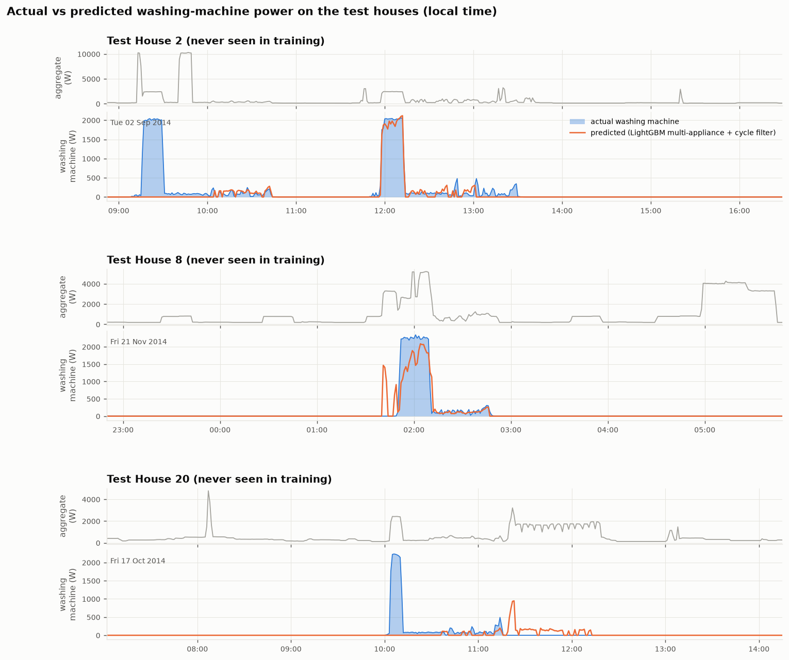
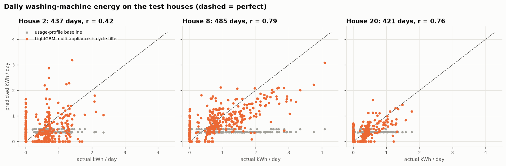
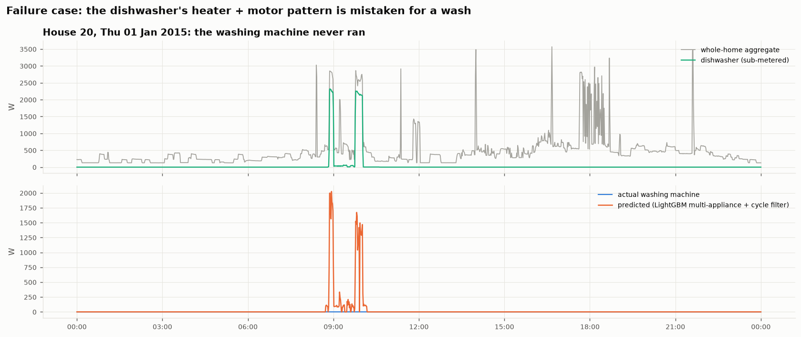

# RESULTS.md — washing-machine EDA and disaggregation model

Figures are in [`figures/`](figures/) and tables in [`results/`](results/); everything is regenerated by
the scripts listed in the README. All times in this file are **UK local time** (Europe/London); the
CLEAN timestamps are UTC (DATA.md §6), so they are converted before any hour-of-day analysis.

---

## Section 2 — Washing-machine use in the official CLEAN data

**Homes and periods.** 14 homes: 1, 2, 5, 6, 7, 8, 9, 10, 15, 16, 17, 18, 19, 20, at 1-minute
resolution, each over its full CLEAN record (earliest Sep 2013, latest Jul 2015). Together that is
**6,801 observed house-days**. See DATA.md §6 for why homes 3, 4, 11, 13 and 21 are excluded.

### 2.1 Rule for an active wash cycle

In plain language: **the machine is running when it draws more than 20 W. Pauses of up to 15
minutes still belong to the same wash. A wash must last at least 10 minutes and use at least
0.05 kWh.**

| Element | Value | Why |
|---|---|---|
| ON threshold | **> 20 W** | Standby is < 10 W in every house (House 5 idles at 1–5 W for 41 % of the time); 20 W is also the washing-machine threshold used by Kelly & Knottenbelt (2015) |
| Merge pauses | **≤ 15 min** | A wash stops drawing power while filling, soaking and draining. Pauses between ON stretches are mostly 1–5 min (inside a wash) or > 4 h (between washes); 15 min sits in the sparse middle |
| Minimum size | **≥ 10 min and ≥ 0.05 kWh** | Event energy is bimodal: blips (display, door lock) < 0.02 kWh vs washes at 0.2–1 kWh. 1,682 blips rejected |
| Missing data | outages and **frozen readings** are missing, never "off" | a cycle touching missing data is counted but flagged *truncated* (234 of 4,951) and excluded from duration/energy comparisons |

*Left:* the pause distribution has a large mass at 1–3 min and a broad hump at hours to days, with
no clean valley in between. The 15-minute merge is therefore a judgement call, so we test it below.
*Right:* blips and real washes form two clearly separate groups; the 0.05 kWh line sits in the gap.

**Sensitivity** ([`results/s2_rule_sensitivity.csv`](results/s2_rule_sensitivity.csv)): total cycles
under other settings.

| merge gap \ min energy | 0.02 kWh | **0.05 kWh** | 0.10 kWh |
|---|---|---|---|
| 5 min | 5,404 | 5,181 | 5,024 |
| 10 min | 5,234 | 5,049 | 4,916 |
| **15 min** | 5,114 | **4,951** | 4,830 |
| 30 min | 4,863 | 4,730 | 4,624 |
| 60 min | 4,620 | 4,497 | 4,398 |

Changing the merge gap from 10 to 30 minutes moves the count by under ±5 %, so the conclusions
below do not hinge on the exact values.

**A data-quality problem found by the rule: frozen readings.** In the CLEAN data, a monitor that
stopped reporting can show its last value repeated for hours, because the official pipeline
forward-fills. A real machine's power changes every minute, so **an identical reading above 20 W
for 30+ minutes is treated as missing**. This removes 2.4 % of House 5's minutes (124 runs, up to 2 days
long) and ≤ 0.04 % elsewhere. Without it, House 5 showed "washes" lasting 13 hours at a constant
2,129 W.

### 2.2 Availability and data quality

From [`results/s2_availability.csv`](results/s2_availability.csv). "Zero" and "standby" are shares
of *observed* minutes; "outage" is the share of the whole span.

| House | Period | Observed days | Outage % | Outages > 1 day | Zero % | Standby (0–20 W) % | In a cycle % | Cycles (truncated) | Cycles / week |
|---|---|---|---|---|---|---|---|---|---|
| 1 | 2013-10-09 → 2015-07-10 | 559 | 12.5 | 12 | 97.6 | 0.6 | 2.0 | 380 (24) | 4.8 |
| 2 | 2013-09-17 → 2015-05-28 | 466 | 24.6 | 11 | 94.4 | 0.9 | 5.0 | 324 (31) | 4.9 |
| 5 | 2013-09-26 → 2015-07-06 | 574 | 9.2 | 9 | 53.5 | 41.2 | 5.4 | 674 (81) | 8.2 |
| 6 | 2013-11-28 → 2015-06-28 | 491 | 15.0 | 13 | 97.4 | 0.7 | 1.9 | 123 (10) | 1.8 |
| 7 | 2013-11-01 → 2015-07-08 | 537 | 12.5 | 11 | 74.9 | 16.8 | 8.4 | 836 (17) | 10.9 |
| 8 | 2013-11-01 → 2015-05-11 | 499 | 10.2 | 8 | 84.1 | 12.6 | 3.4 | 369 (2) | 5.2 |
| 9 | 2013-12-17 → 2015-07-08 | 481 | 15.3 | 9 | 90.6 | 6.7 | 2.7 | 243 (7) | 3.5 |
| 10 | 2013-11-20 → 2015-06-30 | 523 | 10.9 | 12 | 90.2 | 1.1 | 9.0 | 594 (25) | 8.0 |
| 15 | 2013-12-17 → 2015-07-08 | 491 | 13.5 | 11 | 96.2 | 0.9 | 3.1 | 248 (10) | 3.5 |
| 16 | 2014-01-10 → 2015-07-08 | 450 | 17.2 | 14 | 93.3 | 3.0 | 3.8 | 306 (8) | 4.8 |
| 17 | 2014-03-06 → 2015-06-19 | 441 | 6.1 | 6 | 96.6 | 1.0 | 2.6 | 279 (5) | 4.4 |
| 18 | 2014-03-07 → 2015-05-24 | 417 | 5.8 | 7 | 98.5 | 0.3 | 1.2 | 132 (3) | 2.2 |
| 19 | 2014-03-06 → 2015-06-20 | 441 | 6.3 | 7 | 86.6 | 9.6 | 3.9 | 255 (8) | 4.0 |
| 20 | 2014-03-20 → 2015-06-23 | 433 | 5.9 | 6 | 97.2 | 0.4 | 2.5 | 188 (3) | 3.0 |
| **All** | | **6,801** | | | | | | **4,951 (234)** | |

What this shows:
- **The machine is idle 91–98 % of the time.** That class imbalance shapes the model evaluation in
  Section 3.
- **"Zero" is not the same as "off".** Some machines report an exact 0 when idle, others a 1–20 W
  standby (Houses 5, 7, 8, 19). Separately, CLEAN zero-fills gaps longer than 2 min, so zero time is
  an *upper bound* on true off time (DATA.md §7).
- **Every house has 6–14 outages longer than a day, and the long ones are simultaneous.** All homes
  that were recording went dark together on 24 Jan – 5 Mar 2014 (41 days), 22–24 Mar, 3–6 Apr,
  11–19 May and 11–17 Jun 2015. These are central data-collection failures, not household problems,
  so no home can stand in for another during them.
- Truncated cycles are rare (4.7 %) except in House 5 (12 %, from frozen-sensor gaps) and House 2
  (10 %, worst coverage).

### 2.3 Cycle characteristics across homes

Complete cycles only ([`results/s2_cycle_summary.csv`](results/s2_cycle_summary.csv)). Over all
4,717 complete cycles: median **71 min**, **0.54 kWh**, peak **2.1 kW**.

| House | Cycles | Duration, median (IQR) min | Energy, median (IQR) kWh | Peak, median W | WM share of house electricity |
|---|---|---|---|---|---|
| 1 | 356 | 33 (32–36) | 0.32 (0.26–0.36) | 2,327 | 2.2 % |
| 2 | 293 | 98 (91–107) | 0.64 (0.51–0.71) | 2,092 | 3.9 % |
| 5 | 593 | 46 (35–77) | 0.30 (0.21–0.49) | 2,078 | 3.1 % |
| 6 | 113 | 130 (77–133) | 0.68 (0.50–0.92) | 2,059 | 1.5 % |
| 7 | 819 | 61 (58–108) | 0.55 (0.45–0.65) | 2,083 | 6.7 % |
| 8 | 367 | 60 (51–77) | 0.80 (0.62–1.26) | 2,337 | 4.3 % |
| 9 | 236 | 74 (69–80) | 0.67 (0.52–0.89) | 2,210 | 2.6 % |
| 10 | 569 | 120 (119–122) | 0.72 (0.64–0.76) | 2,056 | 4.3 % |
| 15 | 238 | 93 (60–126) | 0.72 (0.41–1.30) | 2,184 | 6.7 % |
| 16 | 298 | 74 (63–83) | 0.64 (0.49–0.79) | 2,050 | 3.5 % |
| 17 | 274 | 61 (42–67) | 0.39 (0.30–0.46) | 2,046 | 2.6 % |
| 18 | 129 | 49 (45–67) | 0.33 (0.26–0.43) | 2,192 | 1.1 % |
| 19 | 247 | 102 (101–103) | 0.24 (0.22–0.28) | 1,759 | 2.2 % |
| 20 | 185 | 74 (69–89) | 0.38 (0.30–0.52) | 2,273 | 2.1 % |

**(iii) Cross-house comparison** — [`figures/s2_cross_house.png`](figures/s2_cross_house.png)

*Interpretation.* The **peak** is almost the same everywhere (~2.0–2.3 kW): it is the water heater,
so peak power identifies the appliance but says little about the household. **Energy per cycle varies
about 3×** between homes (0.24 kWh in House 19 to 0.80 kWh in House 8), mostly because of **wash
temperature**: how long the heater runs, not how long the drum turns. House 19's 100-minute cycles
use only 0.24 kWh (its peak is the lowest, 1.76 kW), consistent with cool washes. **Duration is a
household habit**: Houses 1, 10 and 19 run essentially one programme (IQR of 2–4 minutes), while
Houses 6 and 15 vary widely. **Frequency** ranges from 1.8 to 10.9 washes per week. Weekly washing
energy (frequency × energy) spans 0.7 kWh (House 18) to 6.0 kWh (House 7), 1–7 % of household
electricity. Households differ much more in *how often and how hot* they wash than in the machine.

### 2.4 When washing happens

[`results/s2_share_by_hour.csv`](results/s2_share_by_hour.csv), [`results/s2_share_by_weekday.csv`](results/s2_share_by_weekday.csv).
Each house's cycles are turned into shares first, so heavy users (House 7) do not dominate.

*Interpretation.*
- **Hour of day.** Washing is a morning activity: 41 % of cycles start between 07:00 and 12:00. On
  weekdays starts peak at **09:00** (10.6 %); at weekends the peak moves an hour later, to **10:00**
  (12.2 %). There is a smaller early-evening bump at 17:00–19:00 on weekdays.
- **Day of week.** Saturday is the busiest day (17.2 % of cycles), then Friday (15.8 %) and Monday
  (15.5 %); Tuesday and Sunday are quietest (~12 %). The weekly pattern is mild compared with the
  daily one.
- **Households are very different (heatmaps).** Most homes have a fixed slot (House 6 ≈ 10:00,
  House 10 ≈ 19:00, House 18 ≈ 09:00), and some have a fixed day (House 5: 39 % on Saturdays;
  House 20: 35 % on Mondays). Two homes stand out: **House 8 starts 77 % of its washes between
  00:00 and 07:00** and **House 19 starts 58 % between 22:00 and 01:00**. Both point to a delay timer
  or a cheap night-time tariff (UK "Economy 7"). These households already shift washing off-peak,
  which suggests others could too (Recommendation.md).

### 2.5 Example traces

**(i) A representative day** — [`figures/s2_day_trace.png`](figures/s2_day_trace.png)

House 7 was chosen automatically: its median energy per cycle is closest to the cross-house median,
and this is a fully observed day whose only wash is House 7's most typical cycle. *Interpretation:*
the wash (60 min, 0.56 kWh) is only **4 % of the day's use**. Its ~2 kW heating block is plainly
visible in the aggregate, but the house draws similar 2–4 kW blocks from other appliances at 08:00
and 14:00–18:00 (kettle, cooking, other heating loads). The 2 kW step alone is therefore not enough
to recognise the washing machine. The long, low (~100–200 W) tumbling tail after the heater is the
more distinctive part, but it is small and easily masked. This is the core difficulty for Section 3.

**(ii) Detected cycles** — [`figures/s2_cycle_examples.png`](figures/s2_cycle_examples.png)

The most typical complete cycle from four homes spanning short to long programmes. *Interpretation:*
all four share the same shape. A **heating block** of ~2 kW for 5–20 min comes first; then a long
**wash/rinse** phase at 50–300 W in which the drum turns and stops, dipping briefly below 20 W
(this is why pauses must be merged); then a **spin** bump of 300–550 W at the end. The detected
window (shaded) starts at heating and ends after the spin in every case. They differ in heating
length (energy) and wash length (duration): House 15's heater switches on and off several times
(holding a set temperature), while House 6's 130-minute programme has one heating block and a long,
gentle tumble.

### 2.6 Limitations of the cycle rule

- **Back-to-back loads** separated by < 15 minutes merge into one long "cycle" (e.g. a 178-minute
  event with two heating blocks in House 7). A programme with a pre-wash looks the same at
  1-minute resolution.
- **Washer-dryers on the same channel** do not occur in our homes; Houses 1, 8, 9 and 18 have a
  separate washer-dryer channel that is not analysed here.
- **Cold washes** (no heating block) are kept only if they exceed 0.05 kWh. Very short cold rinses
  could fall below it.

---

## Section 3 — Disaggregation model

**Task:** estimate the washing machine's power each minute from the household aggregate only
(official CLEAN data, 1-minute). Code: [`src/section3_model.py`](src/section3_model.py).

### 3.1 Homes, periods and validation design

| Set | Houses | Period | Used for |
|---|---|---|---|
| Train | 1, 5, 6, 7, 9, 10, 16, 18, 19 | each house's full CLEAN record (Sep 2013 – Jul 2015) | fitting (2.11 M rows: every 3rd minute) |
| Validation | 15, 17 | 2013-12-17 → 2015-07-08; 2014-03-06 → 2015-06-19 | early stopping, the decision threshold τ, choosing between model versions |
| **Test** | **2, 8, 20** | 2013-09-17 → 2015-05-28; 2013-11-01 → 2015-05-11; 2014-03-20 → 2015-06-23 | final evaluation only: **2.01 M minutes, ~1,400 house-days** |

**Why split by household.** A utility applies the model to *new* customers whose machines and habits
it has never seen, so the test should do the same. Splitting by house also prevents leakage:
- Neighbouring minutes are nearly identical, and a random split would put minute *t* in training and
  minute *t+1* in test.
- No house appears in more than one set, so a household's routine or its other appliances cannot
  leak from training into test.
- All features are computed within one house. The usage-profile baseline is learned on training
  houses only. Trees need no scaling, so no statistics are fitted on test data.
- *Stated for completeness:* the definitions in §2 (the 20 W ON level, the cycle rule, the
  frozen-sensor rule) were set by looking at all 14 houses, including the test houses. They define
  *what counts as a wash* (the label and the evaluation unit), not anything the model learns. The
  model never sees a test-house label, and none of these values was tuned to improve test scores.

The test houses differ on purpose: House 2 has 4 occupants and the worst coverage, House 8 has a
separate washer-dryer and washes at night, and House 20 has a tumble dryer and a dishwasher.

**Which minutes are used.** Evaluation uses every minute where the aggregate and the washing
machine were observed (outages and frozen readings excluded). As discussed in §2, the CLEAN
per-sample `Issues` flag fires at almost every appliance switch-on: it marks **11–46 % of washing
minutes vs 1–6 % of idle minutes**, because IAMs report a few seconds ahead of the aggregate.
Discarding flagged minutes would delete the start of most washes, so training instead drops only
minutes where the *1-minute* appliance sum still exceeds the aggregate (0.3–5 %). Evaluation keeps
them, because a deployed model has no sub-meters to apply this check with.

### 3.2 Model

**Inputs (63 features per minute, aggregate only).** Following Seq2Point (Zhang et al., 2018), the
model sees a **window centred on the target minute**, here ±60 min, and predicts the washing machine at
its midpoint. Gradient boosting replaces the CNN: it trains in minutes on a laptop CPU and is easier
to inspect. Features:
- the aggregate above the house's 2-hour rolling minimum ("excess", which removes the always-on
  background load and makes houses comparable), at lags and leads of 1–60 min;
- rolling mean / std / min / max over 5, 15, 31, 61 and 121 minutes;
- minutes with a heater-sized step (> 1.5 kW), share of minutes at drum level (50–600 W), and
  "activity" (mean absolute minute-to-minute change);
- local time of day (sin/cos) and a weekend flag.

**Models compared.** Every model uses the same features and split, and changes one thing at a time.

| Model | What it is | Why it is included |
|---|---|---|
| LightGBM one-stage | a single regressor predicting watts | the first version |
| **LightGBM two-stage** | a classifier estimates P(machine running, > 20 W); where P > τ, a regressor trained only on running minutes gives the watts, otherwise 0 | separates "when" from "how much" (Precioso & Gómez-Ullate, 2020) |
| **Random forest two-stage** | the same design with scikit-learn random forests (100 trees, 25 % sample per tree, leaves ≥ 20 minutes; fixed in advance, not tuned) | the assignment's suggested model; checks whether the result depends on the boosting library |
| **LightGBM multi-appliance** | the classifier learns **three classes**: washing machine / look-alike (dishwasher, tumble dryer or washer-dryer running) / neither. It reuses the same watts regressor | targets the main failure: look-alikes get their own class instead of being lumped in with "nothing on", so they compete with the washing machine for the same signal |
| **"+ cycle filter"** | any of the above, keeping predicted power only inside predicted events that pass the Section 2 cycle rule (≥ 10 min, ≥ 0.05 kWh) | removes short false alarms with a rule we already justified, with nothing new to tune |

The look-alike labels come from the training and validation homes' own dishwasher, tumble-dryer and
washer-dryer channels (readme). The same frozen-sensor rule is applied to those channels: House 10's
dishwasher channel alone held 44,222 frozen minutes that would otherwise have been labelled
"running". Training rows: 1,936,337 neither, 87,988 washing machine, 87,474 look-alike. **Test
homes' appliance channels are never used for training.**

**Choosing τ and the final model, on validation only.** Each two-stage model's τ is the value with
the lowest validation MAE (0.2 for both LightGBM models, 0.3 for the forest;
[`results/s3_validation_model_choice.csv`](results/s3_validation_model_choice.csv)). The final model is then the
learned model with the **lowest validation MAE**, a rule written into the code before these
models were run (all metrics: [`results/s3_metrics_validation.csv`](results/s3_metrics_validation.csv)):

| Validation houses 15 + 17 (pooled) | MAE (W) | Energy error | Precision | Recall | F1 |
|---|---|---|---|---|---|
| Always off | 13.9 | −100 % | – | 0 | 0 |
| LightGBM one-stage | 9.8 | −46 % | 0.54 | 0.83 | 0.66 |
| LightGBM one-stage + cycle filter | 9.4 | −51 % | 0.71 | 0.77 | 0.74 |
| LightGBM two-stage | 7.1 | −21 % | 0.83 | 0.73 | 0.78 |
| LightGBM two-stage + cycle filter | 7.0 | −23 % | 0.85 | 0.72 | 0.78 |
| Random forest two-stage | 8.3 | −34 % | 0.83 | 0.60 | 0.70 |
| Random forest two-stage + cycle filter | 8.2 | −37 % | 0.85 | 0.58 | 0.69 |
| LightGBM multi-appliance | 6.8 | **−18 %** | 0.84 | **0.74** | **0.79** |
| **LightGBM multi-appliance + cycle filter (final)** | **6.6** | −20 % | **0.86** | 0.73 | **0.79** |

History, for transparency: the one-stage model was built first, and its test scores were seen
before the two-stage design existed. The random forest, multi-appliance model and cycle filter were
added after the two-stage test scores had been seen. In both cases the choice was made on the
validation table above, and **every model is reported on test**.

Two other ideas were tried in quick development experiments on the validation houses (scratch runs,
not part of the pipeline, on an earlier version of the validation minutes). Both were rejected:
- an **L1 objective** instead of L2: MAE 11.5 vs 9.1 W, energy −81 % vs −44 %;
- **raising the one-stage zero threshold** from 20 W to 400 W: F1 fell from 0.67 to 0.28.

### 3.3 Metrics and why each matters

| Metric | What it answers | Why it is needed |
|---|---|---|
| **MAE** (W per minute) | how far off is each minute? | the standard NILM metric, but dominated by the ~97 % idle minutes |
| **MAE when running** (W) | how well is a running machine tracked? | removes the idle-time dilution |
| **Energy error** (%) | is total washing energy over the period right? | what a bill breakdown or savings estimate needs |
| **Daily energy MAE** (kWh/day) | how wrong is each day's washing energy? | the granularity of a customer insight ("you washed 3 times this week") |
| **On/off precision, recall, F1** | does it know *when* the machine runs? | always-off scores F1 = 0, so this exposes the imbalance |
| **Cycle recall / precision** | how many washes are found / how many detected washes are real? | the Section 2 cycle rule applied to both actual and predicted series, matched by overlap |

### 3.4 Results on the unseen test houses

[`results/s3_metrics_test.csv`](results/s3_metrics_test.csv). Pooled over Houses 2, 8 and 20; mean actual
washing energy was 0.46 kWh/day.

| Model | MAE (W) | MAE when running (W) | Energy error | Daily energy MAE (kWh) | Precision | Recall | F1 | Cycle recall | Cycle precision |
|---|---|---|---|---|---|---|---|---|---|
| Always off | **19.0** | 540 | −100 % | 0.46 | – | 0 | 0 | 0 % | – |
| Usage profile | 34.0 | 521 | −12 % | 0.48 | 0.04 | 0.47 | 0.08 | 55 % | 16 % |
| LightGBM one-stage | 22.5 | 408 | −27 % | 0.31 | 0.26 | **0.65** | 0.38 | **88 %** | 40 % |
| LightGBM one-stage + cycle filter | 20.8 | 414 | −38 % | 0.31 | 0.36 | 0.57 | 0.44 | **88 %** | 40 % |
| LightGBM two-stage | 20.5 | 361 | −8 % | 0.28 | 0.55 | 0.48 | 0.51 | 80 % | 53 % |
| LightGBM two-stage + cycle filter | 19.6 | 367 | −16 % | 0.28 | 0.59 | 0.45 | 0.51 | 80 % | 53 % |
| Random forest two-stage | 21.3 | 390 | −18 % | 0.29 | 0.53 | 0.41 | 0.46 | 72 % | 51 % |
| Random forest two-stage + cycle filter | 20.4 | 400 | −27 % | 0.29 | 0.56 | 0.36 | 0.44 | 72 % | 51 % |
| LightGBM multi-appliance | 20.2 | **348** | **−7 %** | **0.28** | 0.56 | 0.48 | **0.51** | 80 % | **53 %** |
| **LightGBM multi-appliance + cycle filter (final)** | 19.2 | 355 | −15 % | **0.28** | **0.59** | 0.45 | 0.51 | 80 % | **53 %** |

Per house (final model): House 2: F1 0.33, energy −21 %, 64 % of washes found; House 8: F1 0.72,
energy −14 %, 93 % found; House 20: F1 0.44, energy −3 %, 80 % found.

**Interpretation.**
- **The learned models beat both baselines on everything that needs timing or energy.** With the
  final model, daily-energy error is 39 % lower than always-off (0.28 vs 0.46 kWh) and 4 of 5 washes
  are found, with 53 % of detected washes real (the usage profile manages 16 %). The usage profile
  gets total energy roughly right (−12 %) but cannot say *when*: it "detects" 2,787 washes for 881
  real ones.
- **Multi-appliance: a small but consistent gain.** It improves on the two-stage model on validation
  (MAE 7.1 → 6.8 W, F1 0.78 → 0.79) and on test (MAE 20.5 → 20.2 W, energy −8 % → −7 %, cycle precision
  52.6 % → 53.2 %). The gain is small because the binary classifier already saw dishwasher minutes,
  as "not a wash". Naming them as their own class sharpens the boundary but adds no new
  information, and the 1-minute aggregate alone cannot fully separate the look-alikes (§3.6).
- **Random forest is worse than LightGBM** on validation (F1 0.70 vs 0.78) and test (F1 0.46 vs 0.51,
  energy −18 % vs −8 %), though it still beats both baselines. The result therefore does not hinge on
  an unusual model. Boosting simply fits these features better than a forest with fixed settings.
- **The cycle filter is a trade-off, not a free gain.** It lowers MAE for every model (final model
  20.2 → 19.2 W) and raises minute precision (0.56 → 0.59) by deleting short false alarms. But it also
  deletes some genuine running minutes, so recall drops and total energy is under-estimated more
  (−7 % → −15 %). Cycle-level recall and precision cannot change: the filter only removes events
  that are not cycles. The selection rule (lowest validation MAE) picks the filtered version. **If
  total energy is the priority, the unfiltered multi-appliance model is the better choice**, at
  −7 % energy error.
- **Always-off still has the lowest per-minute MAE** (19.0 vs 19.2 W), now by only 1 %. This is the
  known weakness of point-wise metrics for rare, spiky loads. Missing a wash costs the energy once,
  but predicting it a few minutes off costs it twice (a miss plus a false alarm), so a model that
  does nothing looks good. On validation the final model halves always-off's MAE (6.6 vs 13.9 W); on
  the test houses false alarms from other heating appliances erase that margin (§3.6). We report MAE
  but do not judge the models by it alone.
- **Generalisation varies by house.** Validation F1 was 0.79 but test F1 is 0.51, ranging from 0.33
  to 0.72 by house. With only 2 validation and 3 test homes, expect ±0.2 F1 on a new home.
- **What the final classifier relies on** ([`results/s3_feature_importance.csv`](results/s3_feature_importance.csv),
  share of gain by feature group): counts of **heater-sized minutes** in the surrounding hour (35 %),
  **minute-to-minute "activity"**, i.e. the drum tumbling (24 %), rolling statistics (18 %), and time of
  day (5 %). Both top groups only exist at minute resolution (see Recommendation.md, 15/30-minute
  data).

### 3.5 Actual vs predicted on evaluation data

[`figures/s3_actual_vs_predicted.png`](figures/s3_actual_vs_predicted.png): the final model on one typical
wash per test house (chosen automatically as the cycle closest to that house's median), with the
aggregate above.

- **House 8** (night wash, 02:00): heater block, tumbling and spin are all tracked; a 3 kW step just
  before causes a brief false start.
- **House 2**: the 12:00 wash is matched closely. The 09:15 wash's heating is **missed** because a
  ~10 kW load (probably an electric shower) runs at the same moment and swamps the 2 kW heater.
  The model still recovers the tumbling tail.
- **House 20**: the short heating block at 10:05 is **missed** and only part of the tumbling is
  predicted. From 11:20 a ~1.7 kW cycling load that is not the washing machine produces a **false
  tail**.

[`figures/s3_daily_energy.png`](figures/s3_daily_energy.png): every full test day.

Daily predictions follow actual washing energy in Houses 8 and 20 (r = 0.79, 0.76). House 2 is
weak (r = 0.42): many days with no wash get 0.5–2 kWh of false energy. The usage profile (grey)
is a flat line at ~0.4 kWh/day, right on average and useless day to day.

### 3.6 Failure cases

**1. Other appliances with the same "heater + motor" signature (false alarms).** For each
false-alarm minute of the final model, we checked which other sub-metered appliance was running
([`results/s3_false_positive_sources.csv`](results/s3_false_positive_sources.csv), which also
holds the same breakdown for the binary LightGBM two-stage model):

| Share of false-alarm energy | House 2 | House 8 | House 20 |
|---|---|---|---|
| Dishwasher | **46 %** | – | **28 %** |
| Tumble dryer | – | – | **31 %** |
| Washer-dryer | – | 7 % | – |
| Kettle / microwave / toaster | 8 % | 4 % | 3 % |
| No other *metered* appliance | 46 % | **89 %** | 38 % |

Dishwashers and tumble dryers heat at ~2 kW and then run a low-power motor: at 1-minute
resolution, from the aggregate alone, they look like a wash. Even the multi-appliance model, which
was trained to tell them apart, still confuses them: the shares above barely moved from the binary
model's (dishwasher 45 % and 31 %, tumble dryer 30 %). That points to a limit of the information in a
1-minute aggregate, not of the model. Kettles are rarely confused, because they are too short and have
no motor tail. Most of House 8's false alarms happen when no metered appliance
is on: an un-metered load (immersion heater, oven, shower) is responsible, which a utility could
never check.

*Example:* on New Year's Day in House 20 the washing machine never ran. The dishwasher's two 2.3 kW
heating blocks, joined by a low pump load, were predicted as a ~2 kW wash.

**2. Washes that use little energy (misses).** Of the 845 complete test cycles, the final model
found 684 and missed 161 ([`results/s3_missed_vs_detected_cycles.csv`](results/s3_missed_vs_detected_cycles.csv)):

| | Cycles | Energy (median) | Duration | Peak | Other load during the wash |
|---|---|---|---|---|---|
| Detected | 684 | 0.69 kWh | 76 min | 2,283 W | 441 W |
| Missed | 161 | 0.48 kWh | 88 min | 2,114 W | 228 W |

Missed washes are mostly cooler/longer programmes with less heating, not ones hidden under other
loads. A single large coincident load (the House 2 shower above) can still hide a heater, so both
mechanisms occur. Cold or eco washes, which are increasingly common, are therefore the main blind
spot.

**3. Where else it is likely to struggle.**
- **Homes unlike the training set**, e.g. a washer-dryer on one circuit, or electric heating that
  cycles at 1–2 kW all winter.
- **Simultaneous heating loads**, such as a dishwasher and washing machine run together after dinner.
- **Lower resolution** (Recommendation.md, Section 4).

### 3.7 Research used

| Paper | Idea adopted here |
|---|---|
| Murray, Stankovic & Stankovic (2017), *Scientific Data* 4:160122 | Data limitations: solar homes excluded, IAM-vs-aggregate asynchrony (which explains the `Issues` flag), zero-filling in CLEAN, uptime figures used to validate our pipeline |
| Zhang, Zhong, Wang, Goddard & Sutton (2018), *Sequence-to-point learning with neural networks for NILM*, AAAI ([arXiv:1612.09106](https://arxiv.org/abs/1612.09106)) | "Window in, midpoint out": a centred window of the aggregate predicts the appliance at its middle. We keep the framing and swap the CNN for gradient boosting |
| Kelly & Knottenbelt (2015), *Neural NILM*, BuildSys | 20 W ON threshold for washing machines; activations defined by power and time thresholds; reporting energy and F1 alongside MAE |
| Precioso & Gómez-Ullate (2020), *NILM as a regression versus classification problem: the importance of thresholding* ([arXiv:2010.16050](https://arxiv.org/abs/2010.16050)) | Separate "is it on?" (classification) from "how much?" (regression); tune the decision threshold; MAE alone is misleading for sparse appliances |
| D'Incecco, Squartini & Zhong (2020), *Transfer learning for NILM*, IEEE Trans. Smart Grid | Evaluate on houses not seen in training, because performance on new homes is what matters and it drops |

### 3.8 What I would do next

1. **Wider evaluation:** use leave-one-house-out cross-validation over all 14 homes instead of one
   fixed 9/2/3 split, so that per-house variance (±0.2 F1) gets a proper confidence interval.
2. **Full multi-appliance disaggregation:** predict the watts of the dishwasher and tumble dryer as
   well, and share the aggregate's energy between the appliances. The look-alike *class* helped only
   a little, because it adds no new information. Sharing energy, or adding inputs a utility might
   have (e.g. reactive power from newer meters), is the next step against the main failure.
3. **Seq2Point CNN** on the same split for a direct comparison; the literature suggests it learns
   cycle shapes better, at the cost of GPU training and harder inspection.
4. **Per-house calibration:** a few days of labelled data from a new home (e.g. a customer
   confirming "I washed today") could correct house-specific bias.
